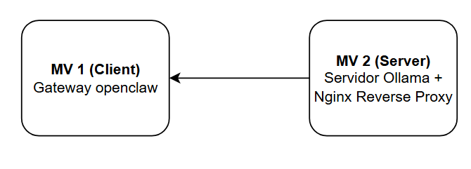

# AEA3 · Desplegament d'OpenClaw

| | |
|---|---|
| **Durada** | 2 h aprox. |
| **Resultats d'aprenentatge** | [RA1](../../modul/resultats-aprenentatge.md#ra1), [RA2](../../modul/resultats-aprenentatge.md#ra2) |
| **Criteris d'avaluació** | 1.1, 1.2, 1.3, 1.4, 2.1, 2.4 |
| **Instruments d'avaluació** | Examen |
| **Modalitat** | En grup |
| **Teoria relacionada** | [6. Orquestració d'agents amb OpenClaw](../teoria/06-openclaw.md) |
| **Ús d'IA permès** | *Pendent d'indicar* |

Desplegament i configuració inicial de l'orquestrador OpenClaw.

[:material-file-word: Descarrega el document de l'activitat (.docx)](fitxers/DAW_M0617_BA1-AEA3_Desplegament_OpenClaw_2026-27.docx){ .md-button .md-button--primary }

## Objectius

1. Instal·lar i gestionar entorns d'execució de [Node.js](https://nodejs.org/){ target=_blank } en Ubuntu Server.
2. Configurar un servei *daemon* d'OpenClaw.
3. Consumir un model LLM mitjançant una API REST.
4. Desplegar i auditar la seguretat d'un agent de sistema capaç d'executar comandes CLI de diagnòstic de forma autònoma.

## Escenari

L'escenari consta de dues màquines virtuals:

<figure markdown="span">
  { width="560" }
</figure>

| Màquina | Rol | Serveis |
|---------|-----|---------|
| **MV 1** | Client | Gateway d'OpenClaw |
| **MV 2** | Servidor | Servidor Ollama + Nginx com a *reverse proxy* |

!!! tip "Teoria"
    Els passos d'instal·lació i configuració d'OpenClaw es troben a [6. Orquestració d'agents amb OpenClaw](../teoria/06-openclaw.md#configuracio-en-un-sistema-ubuntu).

!!! warning "Seguretat"
    No pugeu mai claus d'API ni credencials al repositori ni a les captures del document de lliurament.

## Lliurament

S'ha d'entregar **un document per grup** amb tot el procés documentat (amb captures).
