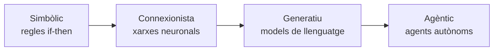

# 1. Fonaments de la IA i evolució

## Què és la intel·ligència artificial?

| Concepte | Definició |
|----------|-----------|
| **Intel·ligència** | La capacitat d'aprendre, comprendre i resoldre problemes. |
| **Intel·ligència artificial** | La intel·ligència exhibida per màquines. |
| **Màquina intel·ligent** | Un sistema que pot percebre el seu entorn i prendre accions que maximitzen les seves possibilitats d'èxit en un objectiu. |

<figure markdown="span">
  { width="300" loading=lazy }
  <figcaption>Tenim ja una màquina intel·ligent?</figcaption>
</figure>

## Intel·ligència humana i intel·ligència computacional

### Intel·ligència humana

- És una **capacitat molt complexa**, adquirida a partir de milions d'anys d'**evolució**.
- Alguns dels seus **aspectes** són: aprendre, resoldre problemes, adaptar-se a nous entorns, prendre decisions, comunicar-se i socialitzar o sentir emocions.
- Encara sabem molt poc sobre com funciona.
- **Turing** deia que la intel·ligència era el resultat de la interacció entre molts processos simples. A partir d'aquesta idea s'han dissenyat gran part dels algorismes que fan servir les nostres màquines avui en dia.

### Intel·ligència computacional

- La intel·ligència artificial intenta entendre i modelar la intel·ligència humana com un procés computacional.
- Intentem modelar programes que s'aproximin al que definim com a intel·ligència, per tal de fer-nos la vida més fàcil.
- La IA és part de la **ciència de la computació**.

### Comparativa

| Intel·ligència humana | Intel·ligència computacional |
|-----------------------|------------------------------|
| Biològica | Computacional |
| General | Específica |
| Conscient | Inconscient |
| Emocional | Racional |
| Adaptativa | Estàtica |
| Evolutiva | Dissenyada |

## Tipus d'intel·ligència artificial

=== "IA feble"

    Feta per a **una sola cosa**. La IA feble s'utilitza comunament en la indústria per millorar l'eficiència i la precisió dels processos. Està dissenyada per fer una sola o un conjunt molt limitat de tasques relacionades amb un alt nivell de competència. La seva funció és estar preparada per actuar en un sol rol, garantint que exerceixi plenament el seu paper.

    !!! example "Exemples"
        Assistents de veu (Siri, Alexa), filtres de correu brossa i cotxes autònoms.

=== "IA forta"

    Buscaria **imitar completament la ment humana**. Podria aprendre i resoldre qualsevol problema nou i tindria capacitat d'adaptació i pensament propi. És un dels objectius principals de la recerca en intel·ligència artificial. La ciència-ficció associa la IA forta amb trets humans com la consciència i la sensibilitat. No s'ha de confondre amb la Intel·ligència Artificial Generativa.

    !!! note
        Actualment és només un objectiu teòric.

## Què és la racionalitat?

- La **raó** o **racionalitat** és una aptitud que consisteix a aplicar normes i lògica en el pensament per obtenir judicis, observacions comprovables o servir de base per a teories.
- El **pensament racional** permet l'abstracció, l'associació d'idees, l'autoconsciència i els símbols, coses que no tenen animals com ara els insectes o la gran majoria de peixos i rèptils, més lligats a l'instint i a una resposta unívoca al medi (per això es diu que no tenen raó, que són irracionals).
- La raó, doncs, també està lligada a **la capacitat per decidir entre diverses alternatives** de conducta.

## Paradigmes de la IA

Els paradigmes són els grans models, enfocaments i filosofies de pensament sobre com crear sistemes intel·ligents. Abasten des de la lògica formal basada en regles humanes fins a models autònoms d'aprenentatge massiu i sistemes orientats a l'acció.

### Paradigma simbòlic

- S'escriuen regles de tipus `if-then` per emular el raonament humà.
- Útil en medicina o dret per prendre decisions basades en dades estructurades.
- **Limitació:** rigidesa davant del món real i dificultat per gestionar la indeterminació o el context complex.

### Paradigma connexionista

- Capes de **nodes interconnectats** que detecten patrons complexos sense regles humanes prèvies.
- El sistema millora amb l'experiència i l'ús massiu d'informació.
- És la base de la visió per computador, el reconeixement de veu i els models actuals.

### Paradigma generatiu

- Processen i combinen de manera simultània veu, imatges i text.
- Generen respostes fluides i naturals a partir de models predictius de llenguatge.

### Paradigma agèntic

- L'agent defineix subtasques, utilitza eines i resol problemes de principi a fi.
- Equips de diferents IA coordinades es reparteixen rols de treball sense intervenció humana constant.

## Quines aplicacions té la IA?

<figure markdown="span">
  { width="260" loading=lazy }
</figure>

### Robòtica

- La robòtica és una de les aplicacions més conegudes de la IA.
- Un robot és un sistema capaç d'interactuar amb el seu entorn.
- Els robots poden ser **autònoms** o **teleoperats**.
- **Camps d'aplicació:** indústria, sanitat, exploració espacial, militar, domèstic, etc.

### Processament del llenguatge natural

- És la capacitat d'un ordinador per entendre el llenguatge humà.
- Els humans utilitzem el llenguatge per comunicar-nos i per transmetre coneixement.
- **Camps d'aplicació:** traducció automàtica, reconeixement de veu, resum de textos, *chatbots*, etc.

### Visió per computador

- És la capacitat d'un ordinador per entendre imatges.
- Els humans utilitzem la visió per entendre el món que ens envolta: ens permet identificar objectes, persones, colors, etc.
- **Camps d'aplicació:** reconeixement facial, reconeixement d'objectes, reconstrucció 3D, reconstrucció de models, etc.

### Altres aplicacions

| Àmbit | Exemples |
|-------|----------|
| **Sistemes de recomanació** | Recomanació de productes, de música, etc. |
| **Jocs** | Jocs de cartes, de tauler, de rol, etc. |
| **Medicina** | Diagnòstic mèdic, cirurgia, medicina personalitzada, etc. |
| **Enginyeria** | Disseny, control de processos, etc. |
| **Finances** | Predicció de mercats, recomanació d'inversions, etc. |
