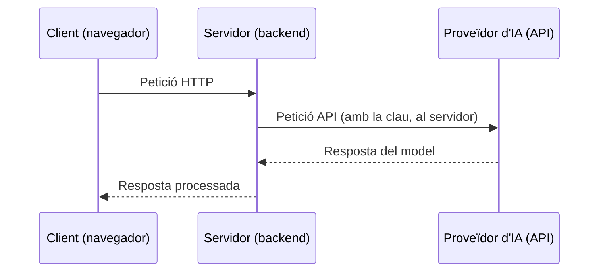

# 2. IA a l'ecosistema web

## El canvi de paradigma al desenvolupament web

Les solucions clàssiques es basen en coincidències exactes i regles fixes, i fallen quan l'usuari s'expressa de manera natural:

=== "Cerca tradicional"

    ```sql
    SELECT * FROM productes WHERE descripcio LIKE '%cadira%';
    ```

    Si l'usuari escriu *"seient d'oficina ergonòmic"*, el resultat és **buit**.

=== "Moderació estàndard"

    Llistes negres de paraules prohibides (*bad-words regex*).

    Són fàcilment eludibles amb jocs de caràcters (`$h1t`), espais buits o sarcasme.

!!! success "Solució amb IA"
    Processament semàntic, reconeixement de patrons i models probabilístics integrats com a **serveis externs**.

## Arquitectura d'integració a la web

Com s'ubica la IA dins d'un *stack* clàssic de desenvolupament web?

La IA s'ubica principalment al **servidor**, que actua com a intermediari segur: rep la petició HTTP del client i fa una altra petició interna via API a un proveïdor extern.



## Camps d'aplicació

La IA ha passat a ser més que un complement i s'està convertint en el nucli de la personalització i optimització del desenvolupament web.

### E-commerce i retail

La IA aplicada a l'experiència d'usuari i la conversió:

#### Cerca semàntica

- **Com funciona:** S'utilitzen models d'incrustació (*embeddings*, com ara vectors generats per LLMs o models especialitzats) per mapejar tant el catàleg de productes com les consultes dels usuaris en un espai vectorial d'alta dimensió.
- **Avantatge web:** Permet entendre la intenció de l'usuari més enllà de la concidència exacta de paraules clau. Si un client cerca "abric càlid per a la pluja a la muntanya", el sistema entén el concepte i pot retornar una parka impermeable d'excursionisme, encara que el títol del producte no contingui exactament les mateixes paraules.

#### Sistemes de recomanació contextuals

- **Com funciona:** Combinen l'historial de navegació i compres amb dades en temps real: la ubicació geogràfica, la meteorologia actual, l'hora del dia, el dispositiu utilitzat i el comportament durant la sessió actual (*session-based recommendations*).
- **Avantatge web:** Ofereix productes altament rellevants al moment precís (per exemple, recomanar paraigües o roba d'abric si plou i fa fred a la ciutat des d'on connecta l'usuari), disparant la taxa de conversió (CR) i el tiquet mitjà.

#### Automatització de la gestió de continguts del catàleg

- **Com funciona:** Utilització de models de visió per computador i generació de text per analitzar imatges de productes crues i generar automàticament títols optimitzats per a SEO, descripcions detallades, etiquetes de categorització i atributs tècnics.

- **Avantatge web:** Redueix dràsticament el temps de posada en marxa de nous productes (time-to-market) i manté una estructura de dades neta i consistent a tota la base de dades.

### Seguretat i moderació

Amb l'augment constant de tràfic automatitzat i contingut generat per usuaris, la seguretat web tradicional s'ha de reforçar amb models d'aprenentatge automàtic en temps real.

#### Moderació de continguts en temps real

- **Com funciona:** Integració d'APIs o models lleugers de classificació de text, imatge, àudio i vídeo directament al pipeline de publicació (comentaris, ressenyes, fòrums).
- **Avantatge web:** Filtra automàticament discursos d'odi, assetjament, spam visual o contingut inadequat abans que sigui visible públicament, minimitzant el risc reputacional i legal de la plataforma sense necessitat d'una revisió manual constant.

#### Detecció d'atacs i bots

- **Com funciona:** Els models analitzen patrons de comportament del client al navegador (moviments del ratolí, velocitat de teclejat, patrons de navegació, empremta digital del dispositiu) per distingir usuaris humans legítims de bots maliciosos o scrapers.
- **Avantatge web:** Permet una seguretat transparent i fluida, reduint l'ús de CAPTCHAs molestos que degraden l'experiència d'usuari, alhora que mitiga atacs d'ompliment de credencials i d'esgotament de recursos.

#### Fintech i pagaments

- **Com funciona:** Sistemes de detecció de frau basats en *machine learning* que analitzen milers de senyals transaccionals en mil·lisegons (velocitat de la transacció, import, històries de risc, discrepàncies d'IP/geolocalització).
- **Avantatge web:** Bloqueja transaccions fraudulentes de manera instantània abans que s'executin a la passarel·la de pagament, reduint els reemborsaments (chargebacks) i assegurant el compliment normatiu (com PSD2 / SCA).

### Assistència i CRM

El model tradicional de "crear un tiquet i esperar 48 hores" està sent reemplaçat per sistemes d'atenció immediata, contextualitzats i altament automatitzats.

#### Classificació i encaminament automàtic de tiquets

- **Com funciona:** NLP i classificadors de text analitzen el contingut dels missatges entrants dels clients per determinar automàticament la intenció, el sentiment, la urgència i el departament o agent adequat.
- **Avantatge web:** Redueix el temps de primera resposta (First Response Time) i assegura que les incidències crítiques arribin immediatament als equips especialitzats sense classificació manual.

#### Extracció d'entitats de documents

- **Com funciona:** Models d'Intel·ligència de Documents i visió que processen fitxers adjunts (factures, formularis, contractes o identificacions) penjats per l'usuari al web.
- **Avantatge web:** Extreu automàticament les dades clau (imports, NIFs, dates, noms) i omple els formularis del CRM o del sistema de gestió, eliminant la fricció de la introducció manual de dades per part de l'usuari o de l'agent.

#### Consulta de documentació corporativa (RAG bàsic)

- **Com funciona:** Implementació d'arquitectures de Generació Augmentada per Recuperació (Retrieval-Augmented Generation), on un assistent virtual (xat) té accés a una base de coneixement interna vectoritzada (manuals de producte, polítiques de devolució, FAQs).
- **Avantatge web:** Ofereix respostes precises, contrastades i lliures d'al·lucinacions basades exclusivament en la documentació oficial de l'empresa, operant 24/7 i resolent fins al 70-80% de les consultes recurrents de primer nivell.
