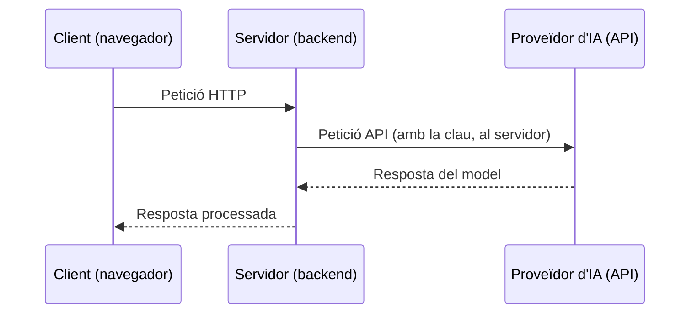
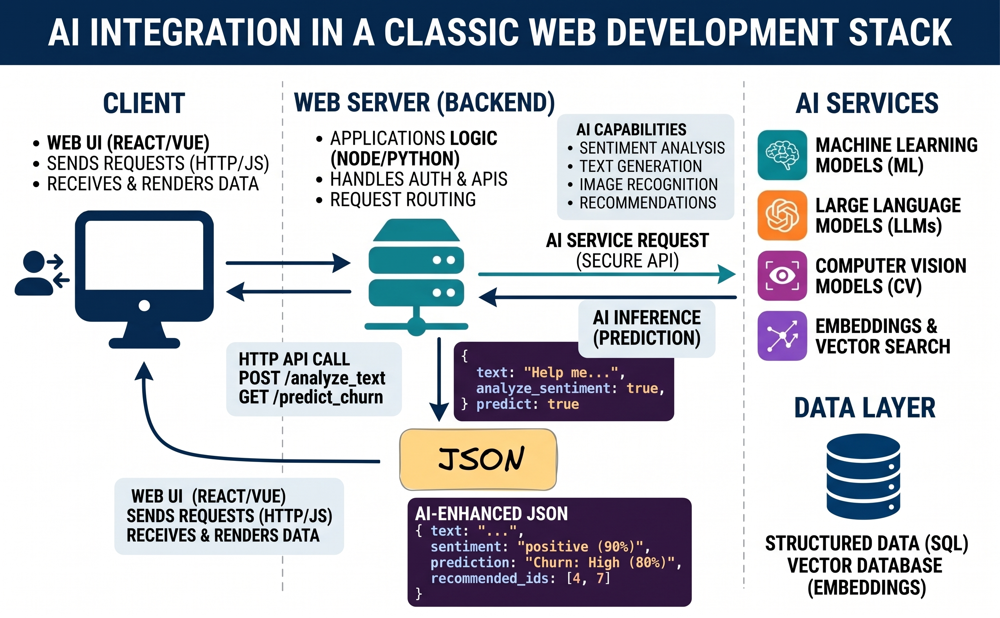
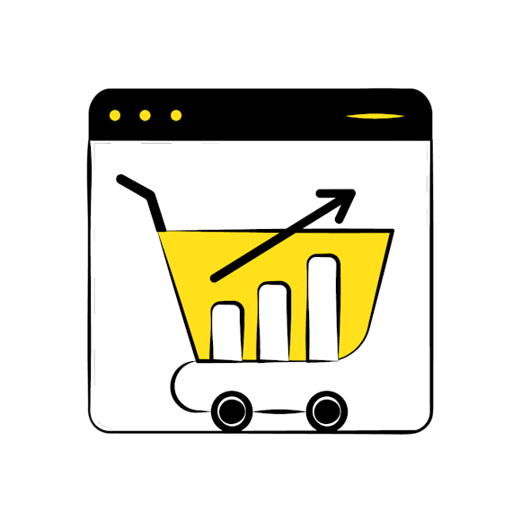
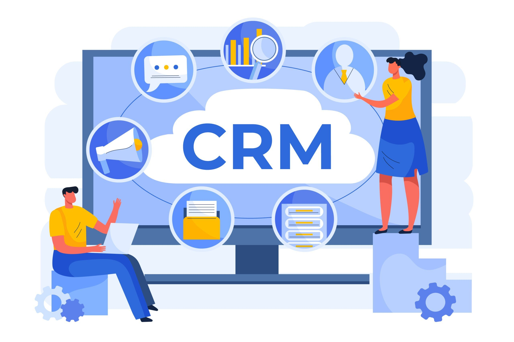

# 2. IA a l'ecosistema web

<span class="etiqueta">RA1</span> Com canvia el desenvolupament web quan hi integrem la IA, on se situa dins l'arquitectura d'una aplicació i quins són els seus principals camps d'aplicació.

## El canvi de paradigma al desenvolupament web

Les solucions clàssiques es basen en coincidències exactes i regles fixes, i fallen quan l'usuari s'expressa de manera natural:

=== "Cerca tradicional"

    ```sql
    SELECT * FROM productes WHERE descripcio LIKE '%cadira%';
    ```

    Si l'usuari escriu *"seient d'oficina ergonòmic"*, el resultat és **buit**.

=== "Moderació estàndard"

    Llistes negres de paraules prohibides (*bad-words regex*).

    Són fàcilment eludibles amb jocs de caràcters (`$h1t`), espais buits o sarcasme.

!!! success "Solució amb IA"
    Processament semàntic, reconeixement de patrons i models probabilístics integrats com a **serveis externs**.

## Arquitectura d'integració a la web

Com s'ubica la IA dins d'un *stack* clàssic de desenvolupament web?

La IA s'ubica principalment al **servidor**, que actua com a intermediari segur: rep la petició HTTP del client i fa una altra petició interna via API a un proveïdor extern.



<figure markdown="span">
  { width="600" loading=lazy }
</figure>

## Camps d'aplicació

### E-commerce i retail

<figure markdown="span">
  { width="360" loading=lazy }
</figure>

La IA aplicada a l'experiència d'usuari i la conversió:

- Cerca semàntica.
- Sistemes de recomanació contextuals.
- Automatització de la gestió de continguts del catàleg.

### Seguretat i moderació

<figure markdown="span">
  { width="480" loading=lazy }
</figure>

Protecció de plataformes i gestió d'usuaris a escala:

- Moderació de continguts en temps real.
- Detecció d'atacs i bots.
- *Fintech* i pagaments.

### Assistència i CRM

<figure markdown="span">
  { width="480" loading=lazy }
</figure>

Canvi radical en el model de suport tècnic web:

- Classificació i encaminament automàtic de tiquets.
- Extracció d'entitats de documents.
- Consulta de documentació corporativa (RAG bàsic).

---

**Activitat relacionada:** [AEA2 · Modernització d'un SaaS](../aea02-modernitzacio-saas/index.md)
