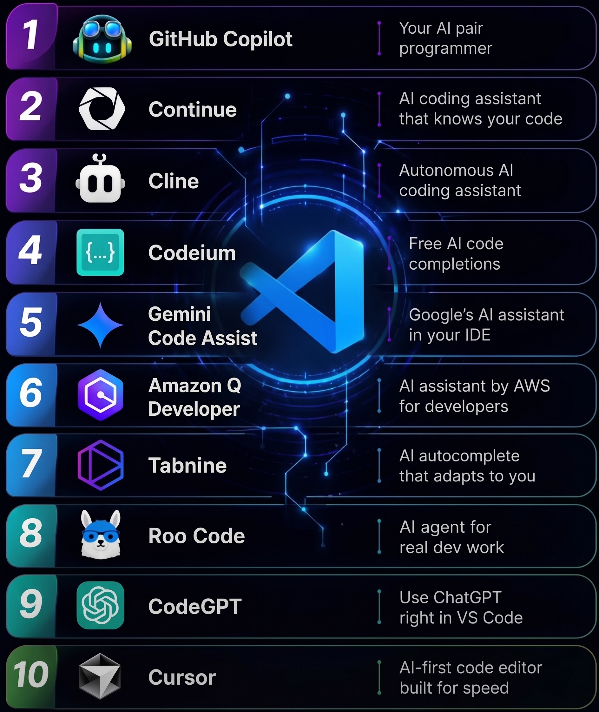

# 3. Assistents per a la programació

RA1 Com ha evolucionat la manera d'interactuar amb la IA mentre programem i quines eines tenim avui a l'abast.

## L'evolució: com interactuem amb la IA?

| Etapa | Forma d'interacció |
|-------|--------------------|
| **2022-2023** | **Finestra de xat externa.** Canvi continu de context: s'havia de copiar i enganxar codi a cegues. L'eina no coneix el nostre entorn d'execució. |
| **2023-2024** | **Autocompletat en línia.** Apareixen els primers panells laterals de xat amb context del fitxer actiu. |
| **Actualitat** | **IDE natius i agents.** Comprensió global de tot el repositori. Execució autònoma de canvis multifitxer i comandes de consola. |

## Classificació de les eines actuals

Podem dividir l'ecosistema en **quatre grans categories**:

1. **Extensions per a IDE tradicionals** (VS Code, JetBrains).
2. **IDE *AI-First*** (entorns dissenyats específicament per col·laborar amb IA).
3. **Solucions *open source* i locals** (privadesa i sobirania de dades).
4. **Agents de terminal / CLI** (automatització de tasques directes sobre Git).

## Extensions per a IDE clàssics

Afegeixen superpoders a les eines que ja coneixem (VS Code, PhpStorm, IntelliJ).

| Eina | Característiques |
|------|------------------|
| **GitHub Copilot** | L'estàndard corporatiu de referència. Autocompletat ràpid basat en context local, xat integrat i accions ràpides sobre el codi seleccionat. |
| **Codeium** | Alternativa molt ràpida amb un nivell gratuït generós per a ús individual. |
| **Gemini Code Assist** | Destaca per la seva enorme finestra de context per analitzar fitxers extensos. |

!!! success "Avantatge"
    No canvies d'editor ni de configuració de dreceres.

!!! failure "Límit"
    La interacció queda limitada pel que permet l'API de l'editor tradicional.

<figure markdown="span">
  { width="520" loading=lazy }
</figure>

## IDE *AI-First*: una nova categoria

*Forks* de VS Code redissenyats des de zero per integrar els models com a copilot actiu. Els exemples més coneguts són **Cursor** i **Windsurf**:

- **Edició multifitxer (*Composer* / *Cascade*):** poden crear, modificar i enllaçar diversos fitxers en un sol pas (p. ex. ruta + controlador + model + migració).
- **Indexació semàntica profunda:** cerquen el codi per significat, no per coincidència de text simple.
- **Integració amb la terminal:** detecten errors de compilació o d'execució i proposen el pegat directament.

## Solucions *open source* i locals

Què passa amb la privadesa, la propietat intel·lectual i el cost?

<figure markdown="span">
  { width="420" loading=lazy }
</figure>

**Execució 100 % local (Ollama):** models especialitzats en codi (*Qwen2.5-Coder*, *DeepSeek-Coder*).

- El codi **mai surt de la nostra màquina**.
- **Zero cost** per ús.
- Funciona completament **fora de línia**.

!!! info
    L'execució de models en local es treballarà al [BA2](../../ba2/index.md).

---

**Activitat relacionada:** [AEA1 · Pràctica de prompting](../aea01-prompt-engineering/index.md)
