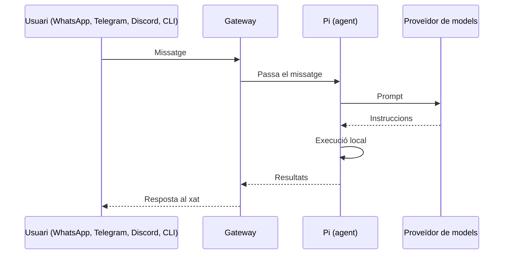
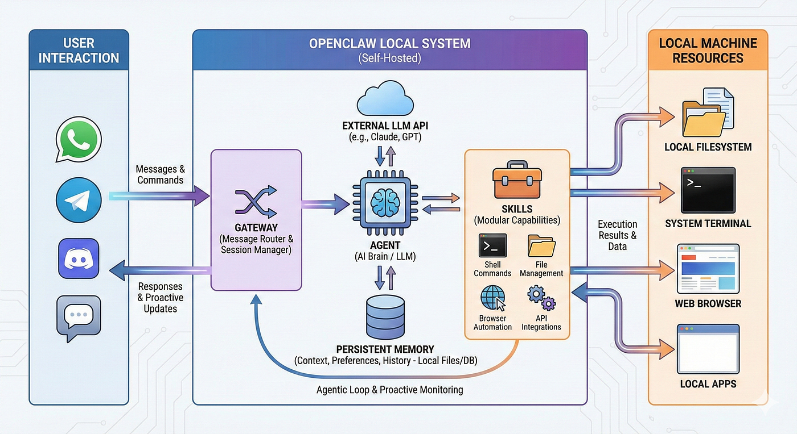

# 6. Orquestració d'agents amb OpenClaw

<span class="etiqueta">RA1</span> <span class="etiqueta">RA2</span> Què és OpenClaw, com funciona la seva arquitectura basada en el *Gateway* i com s'instal·la i configura en un sistema Ubuntu.

## Què és OpenClaw?

**OpenClaw** és un agent d'IA de codi obert i autoallotjat que s'executa en una infraestructura local en lloc d'un servei al núvol gestionat.

Aquest enfocament autoallotjat és fonamental, especialment si fem servir un assistent d'IA que pugui interactuar directament amb els nostres fitxers, processos i entorn operatiu, ja que mantenim el control sobre on resideixen les nostres dades.

<figure markdown="span">
  { width="380" loading=lazy }
</figure>

## L'arquitectura del Gateway

Tot flueix a través d'un únic dimoni anomenat **Gateway**. Es manté en execució en segon pla, manté obertes les connexions de missatgeria i coordina l'agent d'IA. Aquesta és la seqüència quan envies un missatge:

1. El teu text arriba a través de WhatsApp, Telegram, Discord o la CLI.
2. El Gateway el passa a un agent de programació integrat anomenat ***Pi***, que pot executar ordres *shell* en nom nostre.
3. *Pi* envia la indicació (*prompt*) al nostre proveïdor de models.
4. El model respon amb instruccions que *Pi* executa localment.
5. Els resultats de l'execució tornen a través del Gateway cap al nostre xat.



<figure markdown="span">
  { loading=lazy }
  <figcaption>Arquitectura del Gateway d'OpenClaw</figcaption>
</figure>

### El Gateway

El **Gateway** és el procés central i el pla de control local (*control plane*) d'OpenClaw. Funciona com la font principal d'informació i l'orquestrador de tot el sistema. Les seves funcions són:

- Connectar l'assistent amb les diferents plataformes de missatgeria (Telegram, WhatsApp, Discord, Slack, etc.).
- Rebre els missatges entrants, gestionar les sessions dels usuaris i mantenir el context.
- Executar les crides als proveïdors de models de llenguatge (LLM) i invocar les eines i *plugins* necessaris.

## Configuració en un sistema Ubuntu

La configuració d'OpenClaw i d'un agent des de zero es fa mitjançant la seva interfície de línia d'ordres (`openclaw` CLI) i el fitxer de configuració central.

### 1. Instal·lació

Instal·lem les dependències necessàries i OpenClaw:

```bash
sudo npm install -g openclaw@latest
```

### 2. Creació del *workspace*

Executem la comanda que ens permet gestionar la configuració del sistema i crear i configurar el *workspace*:

```bash
openclaw setup
```

- Prepara l'estructura de carpetes, els arxius d'inicialització i l'entorn operatiu on treballa l'agent.
- Permet definir i modificar opcions tècniques del procés central del Gateway, paràmetres d'autenticació i claus de proveïdor.

### 3. Ajustos de configuració

Desactivem la cerca semàntica perquè processi únicament els missatges de la sessió activa:

```bash
openclaw config set memory.search.enabled false
```

Opcionalment, podem ampliar el límit a 300 segons per permetre que el model es carregui (no serà necessari per al model de la pràctica):

```bash
openclaw config set agents.defaults.timeoutSeconds 300
```

### 4. Fitxer de configuració principal

És el fitxer central de la configuració d'OpenClaw. S'hi defineixen:

| Secció | Contingut |
|--------|-----------|
| `providers` | Proveïdors de models i claus API. |
| `channels` | Canals de missatgeria. |
| `messages` / `agents` | Comportament de l'agent i dels missatges. |
| — | Memòria, eines i *plugins*. |
| — | Ajustos del Gateway i de xarxa. |

### 5. Gateway com a servei (*daemon*)

És important configurar el Gateway perquè s'executi com a servei en segon pla (*background service*):

```bash
openclaw daemon install
openclaw daemon restart
```

!!! info
    Així l'assistent funciona contínuament sense dependre de tenir una finestra de terminal oberta, i es reinicia automàticament si cal.

---

**Activitats relacionades:** [AEA3 · Desplegament d'OpenClaw](../aea03-desplegament-openclaw/index.md) · [AEA4 · Agent camp OpenClaw](../aea04-agent-openclaw/index.md)
