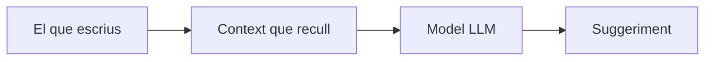

# 7. GitHub Copilot: fonaments i ús

## Què és GitHub Copilot

GitHub Copilot és un **assistent de programació basat en models de llenguatge grans (LLM)**. No "entén" el codi com una persona: a partir del context que li arriba (el fitxer on treballes, altres fitxers oberts, el que li escrius al xat...) **prediu quin és el text més probable** que ve a continuació.

### Com genera un suggeriment



!!! Conseqüència important
    **La qualitat del resultat depèn sobretot de la qualitat del context**. Si el context és pobre o confús, la predicció també ho serà.

### Diferència amb l'autocompletat clàssic

| Autocompletat clàssic (IntelliSense) | GitHub Copilot |
|---|---|
| Es basa en l'anàlisi estàtic del codi (tipus, mètodes que existeixen). | Es basa en probabilitats apreses d'enormes quantitats de codi. |
| Suggereix un nom de mètode o variable. | Pot suggerir línies, funcions o fitxers sencers. |
| El que proposa existeix segur. | El que proposa **pot no existir** (una API, una llibreria, un paràmetre inventat). |
| Determinista. | No determinista: la mateixa petició pot donar respostes diferents. |

### L'ecosistema Copilot

- **Extensió per a l'IDE** (VS Code, JetBrains, Visual Studio...): suggeriments mentre escrius i xat integrat. És el que farem servir a classe.
- **Copilot Chat**: conversa amb el model dins de l'editor o a github.com.
- **Copilot CLI**: l'assistent a la terminal.
- **Coding agent**: a github.com pots assignar una *issue* a Copilot; treballa en segon pla i obre un *pull request* perquè el revisis.

### Altres eines semblants

Copilot no és l'única opció: **Cursor**, **Windsurf**, **Claude Code** o **Continue** (amb models locals via Ollama) en són alternatives. Les vam classificar al [3. Assistents per a la programació](03-assistents-programacio.md).

Les idees que aprendràs aquí (context, modes, prompting, verificació) són transferibles a totes aquestes eines.

### Límits que has de tenir sempre presents

- **Al·lucinacions:** pot inventar funcions, paràmetres o paquets que no existeixen.
- **Codi plausible però incorrecte:** compila i "sembla" bé, però té errors de lògica o casos límit no contemplats.
- **Coneixement desactualitzat:** el model pot proposar sintaxi antiga o APIs obsoletes.
- **Seguretat:** pot reproduir patrons vulnerables (consultes SQL concatenades, falta de validació...). Ho treballarem al punt 9.

!!! warning "Regla d'or"
    El codi que acceptes és teu. Tu n'ets el responsable, l'hagi escrit qui l'hagi escrit.

---

## Posada en marxa

### Plans d'accés

GitHub ofereix diversos plans (gratuït, de pagament individual i per a organitzacions). Els **estudiants verificats** amb **GitHub Education** poden accedir a Copilot sense cost.

!!! note
    Les condicions i els límits de cada pla canvien sovint. Consulta-les a la documentació oficial de GitHub abans de començar.

### Instal·lació a VS Code

1. Tingues un compte de GitHub (si ets estudiant, sol·licita el benefici de GitHub Education).
2. Obre VS Code i instal·la l'extensió **GitHub Copilot** des del panell d'extensions.
3. Inicia sessió amb el teu compte de GitHub quan t'ho demani.
4. Comprova que la icona de Copilot apareix a la barra d'estat i que s'obre el panell de xat.

### Configuració recomanada

- **Selecció de model:** al panell de xat pots triar entre diversos models. Alguns són més ràpids; d'altres raonen millor però consumeixen més quota.
- **Activar o desactivar per llenguatge:** pots desactivar els suggeriments en tipus de fitxer concrets (per exemple, Markdown) des de la configuració.
- **Desactivar-lo temporalment:** des de la icona de la barra d'estat. Útil quan vols practicar sense ajuda.

### Privacitat: fitxers sensibles

!!! danger "Tot el que forma part del context s'envia als servidors del proveïdor"

Per tant:

- **No obris fitxers amb secrets** (`.env`, claus, credencials) mentre treballes amb Copilot.
- Assegura't que els secrets són al `.gitignore` i fora del codi font.
- No enganxis mai al xat dades personals reals, contrasenyes ni claus d'API.

---

## Modes d'interacció

### 1. Suggeriments mentre escrius (*completions*)

Mentre escrius, Copilot proposa codi en gris.

| Acció | Drecera (Windows/Linux) |
|---|---|
| Acceptar el suggeriment | `Tab` |
| Rebutjar-lo | `Esc` |
| Acceptar només la paraula següent | `Ctrl` + `→` |
| Veure el suggeriment següent / anterior | `Alt` + `]` / `Alt` + `[` |

Els **next edit suggestions** van un pas més enllà: si fas un canvi (per exemple, reanomenes un paràmetre), Copilot et proposa les edicions relacionades en altres punts del fitxer. Prems `Tab` per anar-hi i acceptar-les.

### 2. Xat en línia (*inline chat*)

Amb `Ctrl` + `I` obres un petit xat dins de l'editor, sobre el codi seleccionat. És ideal per a **canvis petits i localitzats**:

> *"Afegeix validació perquè el preu no pugui ser negatiu."*

Veuràs el canvi proposat com a diff i decidiràs si l'acceptes.

### 3. Panell de xat i els seus modes

Amb `Ctrl` + `Alt` + `I` obres el panell de xat. Hi ha diversos modes:

| Mode | Què fa | Quan fer-lo servir |
|---|---|---|
| **Ask** | Respon preguntes i explica codi. No modifica fitxers. | Entendre codi, resoldre dubtes, comparar alternatives. |
| **Plan** | Analitza la tasca i proposa un pla pas a pas abans de tocar res. | Tasques mitjanes o grans; quan vols revisar l'enfocament abans d'executar. |
| **Agent** | Edita diversos fitxers, executa ordres a la terminal i itera fins completar la tasca. | Tasques de diversos passos: crear una funcionalitat, refactoritzar, fer passar tests. |

!!! tip "Recomanació"
    Comença per **Ask** o **Plan**. Passa a **Agent** quan tinguis clar què vols i com ho revisaràs.

### Revisar el que fa l'agent

El mode Agent és potent, però **no treballa sol**:

- Revisa cada **diff** abans d'acceptar-lo. Pots acceptar o desfer canvis fitxer a fitxer.
- Quan vulgui executar una ordre a la terminal, et demanarà permís. **Llegeix l'ordre abans d'aprovar-la.**
- Fes servir els **checkpoints** per tornar a un estat anterior si el resultat no et convenç.
- Treballa sempre amb **Git**: fes un commit abans de demanar canvis grans a l'agent. Així sempre pots tornar enrere.

---

## Gestió del context

El context és tot allò que Copilot "veu" quan genera una resposta. Controlar-lo és l'habilitat més important per treballar bé amb qualsevol assistent.

### Què forma part del context

- El fitxer on tens el cursor i el codi seleccionat.
- Altres fitxers oberts a l'editor (per als suggeriments).
- L'historial de la conversació actual (per al xat).
- Les instruccions personalitzades del projecte (ho veurem al punt 8).
- Allò que hi afegeixis explícitament.

### Afegir context de manera explícita

Al xat pots referenciar elements amb `#`:

| Referència | Què afegeix |
|---|---|
| `#file` | Un fitxer concret del projecte. |
| `#selection` | El codi seleccionat a l'editor. |
| `#codebase` | Cerca al conjunt del projecte el codi rellevant per a la pregunta. |

També pots arrossegar fitxers al panell de xat o adjuntar captures de pantalla (per exemple, d'un disseny o d'un missatge d'error).

**Exemple:**

> ❌ *"Per què no funciona el carret?"*
>
> ✅ *"A `#file:cart.js`, la funció `addItem` no actualitza el total quan el producte ja és al carret. Explica'm la causa abans de proposar cap canvi."*

### La finestra de context és limitada

Els models només poden processar una quantitat limitada de text. Si una conversació s'allarga molt o hi barreges temes diferents, el model "oblida" informació o es confon.

### Bones pràctiques

- **Un xat per tasca.** Quan canviïs de tema, obre una conversació nova.
- **Obre només els fitxers rellevants.** Tanca els que no tinguin res a veure amb la tasca.
- **Sigues explícit.** Referencia els fitxers i funcions concrets en lloc d'esperar que Copilot els endevini.
- **Dona el missatge d'error complet** quan depuris, no un resum.

---

## Exemple guiat

Sobre el projecte de botiga en línia de classe:

1. Obre `products.js` i escriu només aquest comentari i la signatura:
   ```js
   // Retorna els productes filtrats per categoria i ordenats per preu ascendent.
   // Si la categoria és buida, retorna tots els productes.
   function filterProducts(products, category) {
   ```
   Observa el suggeriment i **llegeix-lo abans d'acceptar-lo**. Contempla el cas de la categoria buida?
2. Selecciona la funció, prem `Ctrl` + `I` i demana: *"Fes que no modifiqui l'array original."* Revisa el diff.
3. Obre el xat en mode **Ask** i pregunta: *"Quins casos límit no contempla `#selection`?"*
4. Compara la teva valoració amb la de Copilot.

---

## :material-pencil: Prova-ho (15 min)

1. Demana la mateixa funció en mode **Ask**, **Plan** i **Agent**. Anota en una taula quines diferències observes en el procés i en el resultat.
2. Fes la mateixa pregunta amb context pobre i amb context ric (`#file`, codi seleccionat, error complet). Compara les respostes.
3. Busca un suggeriment de Copilot que sigui incorrecte o inventi alguna cosa. Explica per què és erroni.

---

## :material-alert-outline: Errors habituals

- Acceptar suggeriments amb `Tab` sense llegir-los.
- Fer servir el mode Agent per a tot, fins i tot per a preguntes senzilles.
- Aprovar ordres de terminal de l'agent sense mirar què fan.
- Mantenir una sola conversació llarguíssima amb temes barrejats.
- Tenir oberts fitxers amb secrets mentre es treballa amb l'assistent.
- Treballar amb l'agent sense haver fet commit abans.

---

## Per saber-ne més

- [Documentació oficial de GitHub Copilot](https://docs.github.com/copilot)
- [GitHub Copilot a VS Code](https://code.visualstudio.com/docs/copilot/overview)
- [GitHub Education per a estudiants](https://education.github.com/)
