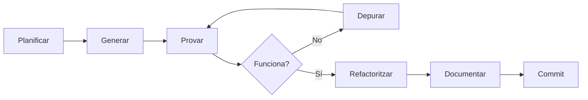
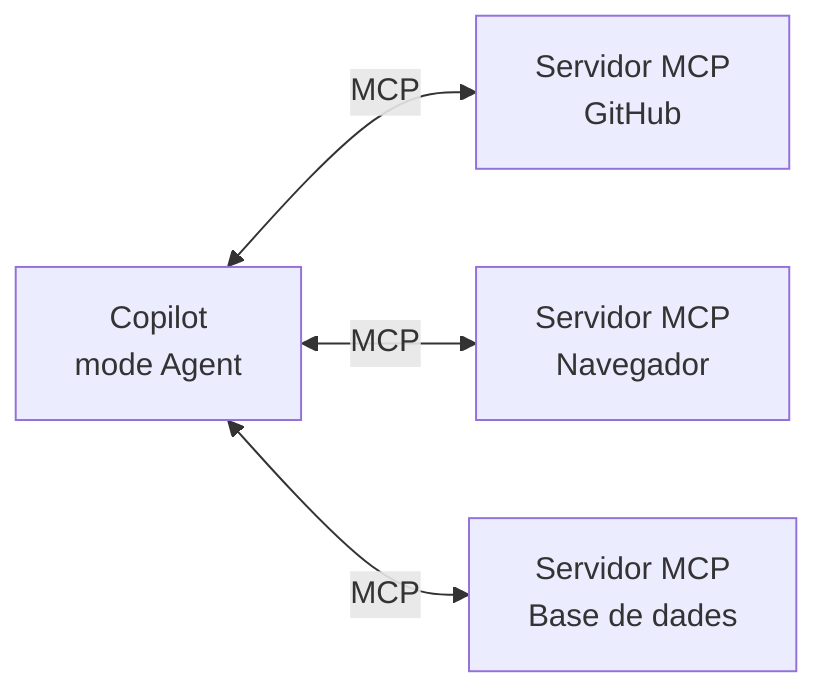

# 8. Prompting i flux de treball amb Copilot

## Prompting per a codi

### Estructura d'un bon prompt de codi

Un prompt de codi eficaç respon quatre preguntes:

| Element | Pregunta | Exemple |
|---|---|---|
| **Objectiu** | Què vull obtenir? | *Crea un endpoint que retorni els productes d'una categoria.* |
| **Context** | On s'ha d'integrar? | *Fes servir el model de `#file:models/product.js` i segueix l'estil de les rutes de `#file:routes/users.js`.* |
| **Restriccions** | Quines condicions ha de complir? | *Valida que la categoria existeixi, retorna 404 si no hi és i no facis servir llibreries noves.* |
| **Format** | Com vull la resposta? | *Primer explica el pla en 3 punts i després mostra només el codi del fitxer de rutes.* |

!!! tip "Sigues concret i mesurable"
    En lloc de *"fes-ho més ràpid"*, escriu *"evita recórrer l'array dues vegades"*. En lloc de *"posa validació"*, escriu *"el preu ha de ser un número positiu amb dos decimals com a màxim"*.

### Exemples comparats

=== "❌ Dolent"

    > *Fes un formulari de registre.*

    El model no sap quins camps vols, quin llenguatge, com s'ha de validar ni on s'integra. Endevinarà, i el resultat difícilment encaixarà amb el projecte.

=== "⚠️ Millorable"

    > *Fes un formulari de registre en HTML amb nom, correu i contrasenya, amb validació.*

    Concreta els camps, però continua deixant obertes moltes decisions: quina validació, si és al client o al servidor, quin estil o què passa en enviar-lo.

=== "✅ Bo"

    > *A `#file:registre.html`, crea un formulari de registre amb nom, correu i contrasenya. Valida al client amb JavaScript sense llibreries: el correu ha de tenir un format vàlid i la contrasenya, 8 caràcters com a mínim amb almenys un número. Mostra els errors sota cada camp i fes servir les classes CSS de `#file:styles.css`. Envia les dades amb `fetch` a `POST /api/usuaris`. No implementis el servidor.*

    Té objectiu, context (fitxers concrets), restriccions verificables, integració amb l'arquitectura client-servidor i límits clars sobre què no s'ha de fer.

### Comentaris i signatures com a prompts

Als suggeriments en línia, el teu prompt és el mateix codi. Si escrius primer **la intenció**, Copilot té molta més informació:

```js
/**
 * Calcula el total del carret aplicant un descompte percentual.
 * @param {Array<{preu: number, quantitat: number}>} items
 * @param {number} descompte Percentatge entre 0 i 100.
 * @returns {number} Total arrodonit a 2 decimals.
 * @throws {RangeError} Si el descompte és fora de rang.
 */
function calcularTotal(items, descompte) {
```

Un bon nom de funció, uns tipus clars i un comentari que descrigui els casos límit valen més que qualsevol petició genèrica.

### Demana un pla abans del codi

En tasques que afecten diversos fitxers, demana primer **com ho farà**:

> *Abans d'escriure codi, explica'm quins fitxers modificaràs i per què. Espera la meva confirmació.*

Pots fer-ho de manera explícita o fent servir el **mode Plan** (tema 7). Així detectes un enfocament equivocat abans que generi centenars de línies que hauràs de revisar.

### *Few-shot* amb codi del projecte

La tècnica *few-shot* (tema 5) és especialment útil en codi: en lloc de descriure l'estil que vols, **ensenya'n un exemple que ja existeixi**.

> *Crea el controlador de comandes seguint exactament la mateixa estructura, gestió d'errors i format de resposta que `#file:controllers/productes.js`.*

### Iterar, no començar de nou

Si la primera resposta no és bona, no la descartis: **corregeix-la amb indicacions concretes** dins de la mateixa conversa.

> *Està bé, però fes servir `async/await` en lloc de `.then()` i extreu la validació a una funció a part.*

Torna a començar en un xat nou només quan la conversa s'hagi desviat del tot o hagis canviat de tasca.

---

## Personalització de Copilot

Si a cada prompt has de repetir *"fem servir PHP 8.3, PDO i noms en català"*, perds temps i acabaràs oblidant-ho. Copilot permet guardar aquestes indicacions en **fitxers Markdown dins del repositori**. D'aquesta manera es versionen amb Git i les comparteix tot l'equip.

!!! info "La mateixa idea que el *system prompt*"
    Aquests fitxers fan la mateixa funció que les **instruccions del sistema** del tema 5 o que la configuració de l'agent d'OpenClaw del tema 6: defineixen el comportament de l'assistent abans que comenci la conversa.

```
el-meu-projecte/
├── .github/
│   ├── copilot-instructions.md      ← instruccions globals del projecte
│   ├── instructions/
│   │   ├── frontend.instructions.md ← instruccions per a certs fitxers
│   │   └── php.instructions.md
│   ├── prompts/
│   │   └── crud.prompt.md           ← prompts reutilitzables
│   └── agents/
│       └── revisor.agent.md         ← agents personalitzats
├── AGENTS.md                         ← instruccions compartides entre eines
└── ...
```

### Instruccions globals: `copilot-instructions.md`

El fitxer `.github/copilot-instructions.md` s'afegeix **automàticament a totes les peticions de xat** del projecte. És el lloc per a la informació que sempre és certa:

```markdown title=".github/copilot-instructions.md"
# Projecte: botiga en línia

## Stack
- Frontend: HTML, CSS i JavaScript sense frameworks.
- Backend: PHP 8.3 amb PDO i MySQL.

## Convencions
- Noms de variables i funcions en català, en camelCase.
- Totes les consultes SQL amb sentències preparades.
- Comenta les funcions amb PHPDoc o JSDoc.

## Arquitectura
- Les rutes de l'API són a `api/` i retornen sempre JSON.
- La lògica de negoci és a `src/`, mai a les vistes.

## No facis
- No afegeixis dependències noves sense demanar-ho.
- No modifiquis els fitxers de `vendor/`.
```

!!! tip "Instruccions curtes i comprovables"
    Escriu frases curtes, concretes i que es puguin verificar. Un fitxer massa llarg ocupa context a cada petició i dilueix les regles importants.

### Instruccions per a fitxers concrets: `*.instructions.md`

Quan una regla només afecta un tipus de fitxer, crea-la a `.github/instructions/` i indica a quins fitxers s'aplica amb `applyTo`, que és un patró *glob*:

```markdown title=".github/instructions/frontend.instructions.md"
---
description: Convencions per al codi del client
applyTo: "**/*.js,**/*.css,**/*.html"
---
- Fes servir `const` i `let`, mai `var`.
- Accessibilitat: tots els camps de formulari necessiten un `<label>`.
- CSS amb variables definides a `:root`; no facis servir colors directes.
```

### Prompts reutilitzables: `*.prompt.md`

Un *prompt file* és una petició que fas sovint, guardada com a plantilla. Es desa a `.github/prompts/` i s'invoca escrivint `/` seguit del nom al xat:

```markdown title=".github/prompts/crud.prompt.md"
---
description: Genera un CRUD complet per a una entitat
agent: agent
---
Crea el CRUD per a l'entitat **${input:entitat:nom de l'entitat}**.

1. Segueix l'estructura de [productes](../../api/productes.php).
2. Crea les rutes GET, POST, PUT i DELETE a `api/`.
3. Valida totes les dades d'entrada i retorna errors en JSON.
4. Fes servir sentències preparades.
5. Al final, mostra una llista dels fitxers creats.
```

Al xat escriuries: `/crud entitat=comandes`.

Camps més habituals de la capçalera:

| Camp | Funció |
|---|---|
| `description` | Descripció breu que es mostra al xat. |
| `agent` | Mode en què s'executa: `ask`, `plan`, `agent` o un agent personalitzat. |
| `model` | Model concret per a aquesta tasca (opcional). |
| `tools` | Eines que pot fer servir (opcional). |

### Agents personalitzats: `*.agent.md`

Un agent personalitzat és un **rol permanent** amb instruccions, eines i model propis. Apareix al selector de modes del xat, al costat d'Ask, Plan i Agent. Es desa a `.github/agents/`:

```markdown title=".github/agents/revisor.agent.md"
---
description: Revisa codi buscant errors i problemes de seguretat sense modificar-lo
tools: ['search/codebase']
---
Ets un revisor de codi sènior especialitzat en aplicacions web.

- No editis cap fitxer: només analitza i informa.
- Comprova validació d'entrades, injecció SQL, XSS i gestió d'errors.
- Classifica cada problema com a crític, important o menor.
- Per a cada problema, indica el fitxer, la línia i una proposta de solució.
```

Limitar les eines (`tools`) és una mesura de seguretat: un agent revisor no necessita poder escriure fitxers ni executar ordres.

### `AGENTS.md`: un estàndard entre eines

`AGENTS.md` és un fitxer a l'arrel del repositori que llegeixen **diversos assistents** (Copilot, Codex, Cursor i d'altres). Si el teu equip fa servir eines diferents, posar-hi les instruccions comunes evita haver de mantenir un fitxer per a cada eina.

!!! note "Quin fitxer faig servir?"
    | Necessitat | Fitxer |
    |---|---|
    | Normes que sempre s'apliquen al projecte | `.github/copilot-instructions.md` o `AGENTS.md` |
    | Normes per a un tipus de fitxer | `.github/instructions/*.instructions.md` |
    | Una tasca que repeteixo sovint | `.github/prompts/*.prompt.md` |
    | Un rol especialitzat amb eines limitades | `.github/agents/*.agent.md` |

!!! warning "La documentació canvia sovint"
    Els noms de camps i les carpetes d'aquests fitxers evolucionen ràpidament. Abans d'utilitzar-los, consulta la documentació oficial de VS Code.

---

## Flux de treball amb Copilot

Copilot pot ajudar en totes les fases del desenvolupament. La clau és fer-lo servir **per passos petits i revisables**, no per generar tota l'aplicació d'una sola vegada.



### Generar components

1. Descriu la funcionalitat i demana un pla (mode Plan).
2. Revisa el pla i corregeix-lo si cal.
3. Deixa que el mode Agent l'implementi o fes-ho tu amb ajuda dels suggeriments.
4. Revisa el diff i prova-ho abans d'acceptar-lo.

### Depurar

Davant d'un error, resisteix la temptació de demanar directament *"arregla-ho"*:

> *En executar `npm test` obtinc aquest error: [error complet]. Explica'm quina pot ser la causa abans de proposar cap canvi.*

Demanar primer **una hipòtesi** t'obliga a entendre el problema i evita que Copilot "arregli" el símptoma en lloc de la causa. Per a errors senzills pots seleccionar el codi i fer servir la comanda `/fix`.

### Refactoritzar i optimitzar

Selecciona el codi i especifica **quin aspecte** vols millorar:

> *Refactoritza `#selection` per eliminar el codi duplicat entre `afegirProducte` i `actualitzarProducte`. No canviïs el comportament extern.*

!!! danger "Refactoritzar sense tests és arriscat"
    Si no tens tests, Copilot pot canviar el comportament sense que te n'adonis. Genera els tests abans de refactoritzar.

### Generar tests

Amb `/tests` o amb una petició explícita:

> *Escriu tests amb Jest per a `#selection`. Inclou el cas normal, una llista buida, quantitats negatives i un descompte fora de rang.*

En **mode Agent**, Copilot pot executar els tests, llegir els errors i corregir el codi fins que passin. Revisa que no "faci trampa" modificant el test en lloc del codi.

### Documentar

- **Comentaris:** selecciona una funció i demana *"Afegeix JSDoc"* o fes servir `/doc`.
- **README:** *"Genera un README amb instal·lació, ús i estructura del projecte a partir de `#codebase`."*
- **Missatges de commit:** el panell de control de codi font de VS Code té un botó per generar el missatge a partir dels canvis.
- **Pull requests:** a github.com, Copilot pot redactar la descripció d'un PR i fer-ne una revisió (*code review*).

### Comandes ràpides del xat

| Comanda | Funció |
|---|---|
| `/explain` | Explica el codi seleccionat. |
| `/fix` | Proposa una correcció per a un error. |
| `/tests` | Genera tests per al codi seleccionat. |
| `/doc` | Afegeix comentaris de documentació. |
| `/nom-prompt` | Executa un *prompt file* del projecte. |

---

## Ampliar l'agent amb MCP

El mode Agent pot fer servir **eines** a més de llegir i escriure fitxers: cercar al projecte, executar ordres a la terminal, llegir una pàgina web... El **Model Context Protocol (MCP)** és un estàndard obert que permet afegir-li eines noves connectant-lo a **servidors MCP**.



Alguns exemples:

- **GitHub:** consultar *issues*, crear branques o obrir *pull requests*.
- **Playwright (navegador):** obrir l'aplicació, fer clic i comprovar que funciona.
- **Base de dades:** consultar l'esquema real per generar consultes correctes.

Els servidors del projecte es configuren al fitxer `.vscode/mcp.json`:

```json title=".vscode/mcp.json"
{
  "servers": {
    "playwright": {
      "command": "npx",
      "args": ["@playwright/mcp@latest"]
    }
  }
}
```

!!! danger "Cada servidor MCP és codi que s'executa amb els teus permisos"
    Instal·la només servidors de fonts de confiança, revisa quines eines exposen i no els donis accés a credencials o dades de producció. Ho aprofundirem al tema 9.

---

## Per saber-ne més

- [Personalitzar Copilot a VS Code](https://code.visualstudio.com/docs/copilot/customization/overview)
- [Prompt files](https://code.visualstudio.com/docs/copilot/customization/prompt-files)
- [Agents personalitzats](https://code.visualstudio.com/docs/copilot/customization/custom-agents)
- [Servidors MCP a VS Code](https://code.visualstudio.com/docs/copilot/customization/mcp-servers)
- [Awesome Copilot: col·lecció d'instruccions, prompts i agents](https://github.com/github/awesome-copilot)
- [AGENTS.md](https://agents.md/)
