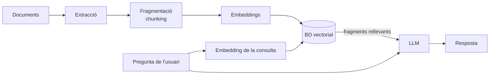

# RA4 · Arquitectures de dades per a IA i RAG

**15 h · Bloc [BA2](../index.md)**

> Dissenya i implementa solucions basades en la generació augmentada per recuperació (*Retrieval-Augmented Generation*, RAG) i bases de dades vectorials.

## Criteris d'avaluació i activitats

| CA | Descripció | Activitats |
|----|------------|------------|
| 4.1 | *Embeddings* de text i multimèdia per a la representació vectorial de la informació. | *Pendent* |
| 4.2 | Bases de dades vectorials (Pinecone, Chroma, Qdrant, pgvector…) per a la cerca per similitud. | *Pendent* |
| 4.3 | *Pipeline* d'ingestió: extracció, *chunking*, generació d'*embeddings* i emmagatzematge. | *Pendent* |
| 4.4 | Sistema RAG complet: cerca vectorial + LLM sobre informació corporativa o privada. | *Pendent* |
| 4.5 | Avaluació del RAG: rellevància, fidelitat, *recall* i *precision*. | *Pendent* |

## Arquitectura d'un sistema RAG

## Continguts

*Pendent de desenvolupar.*

## Materials

- Fitxers: carpeta `fitxers/`
- Codi d'exemple: carpeta `codi/`
